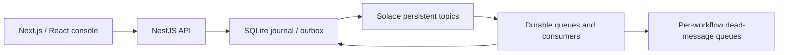

# EventFlow Lab

A portfolio engineering lab for payment authorization and entity onboarding over Solace PubSub+. Both workflows use synthetic events. The same dashboard design is available as a public browser simulation and as a Next.js/React console connected to a NestJS API.

- [Interactive browser demo](https://a-majid-portfolio-mauve.vercel.app/eventflow-lab)
- [Operations runbook and design review](ops/RUNBOOK.md)
- [Camunda and MuleSoft integration boundaries](integrations/README.md)

## Architecture



The API persists a request before returning its UUID. The outbox retries pending sends with the same identifier until broker acknowledgment or consumer progress. Each consumer commits the processing outcome before settling delivery. A duplicate completed event is acknowledged without repeating the effect. A transient failure returns FAILED and the next delivery succeeds. A permanent failure returns REJECTED, allowing the configured broker to move the eligible message to the workflow's dead-message queue. The dashboard journal reflects application outcomes. Verify actual spool and dead-message counts in Broker Manager.

## Run the broker lab

Requires Node 24, npm and Docker Compose. Use two terminals for the API and dashboard after provisioning.

```sh
export SEMP_PASSWORD='choose-a-strong-local-admin-password'
# Set SOLACE_IMAGE to a supported pinned image tag for repeatable runs.
docker compose up -d
# Wait for Broker Manager on http://localhost:8080.
npm ci
node ops/provision.cjs
npm run api
```

```sh
npm run dev
# Open http://localhost:3000.
```

For an existing broker set SOLACE_URL, SOLACE_VPN, SOLACE_USER, SOLACE_PASSWORD and SEMP_URL as appropriate. Provision before starting the API. Use a dedicated lab VPN and a least-privilege application client for shared environments. Keep management credentials with the provisioning operator. The compose broker ports bind to loopback.

## Verify

```sh
npm test
npm run build
node ops/smoke.cjs # With the broker and API running
curl -fsS http://localhost:4000/ready
curl -fsS http://localhost:4000/events -H 'Content-Type: application/json' \
  -d '{"kind":"payment","scenario":"transient"}'
```

Poll GET /events and match the UUID to Completed with two application attempts. Submit a rejected onboarding event and confirm its dead-message queue count increases in Broker Manager. Restart the broker and confirm readiness returns and subsequent events complete. Unit tests cover durable pending state, late acknowledgments, duplicate processing, routing mismatch, retry and rejection.

## Scope

Single-replica lab using SQLite and synthetic business effects. Production work would replace it with a shared transactional database, access-controlled API, business idempotency keys, verified monitoring and load-tested recovery. The public demo runs browser-only and resets on refresh. Camunda BPMN and MuleSoft mapping are integration examples. Kubernetes and OKE deployment resources are templates for a target cluster.
